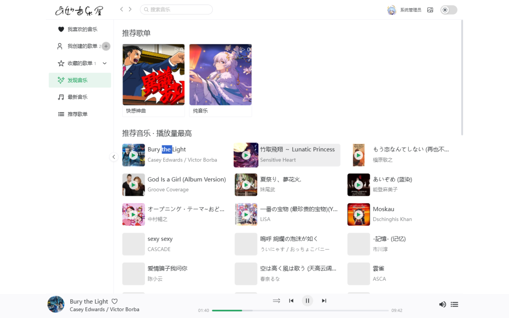
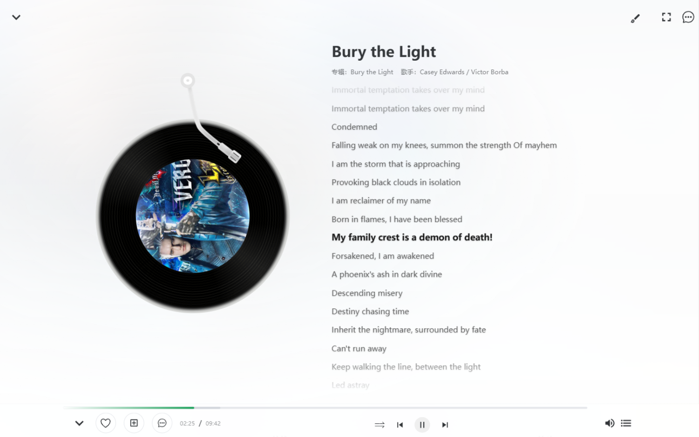
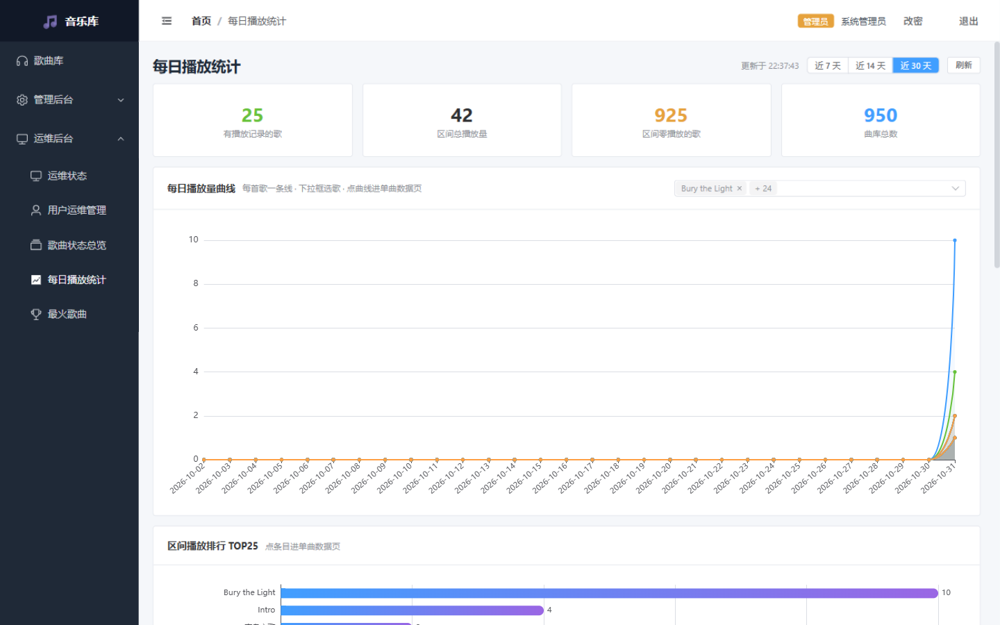
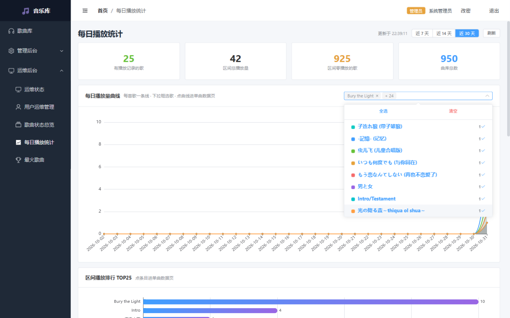
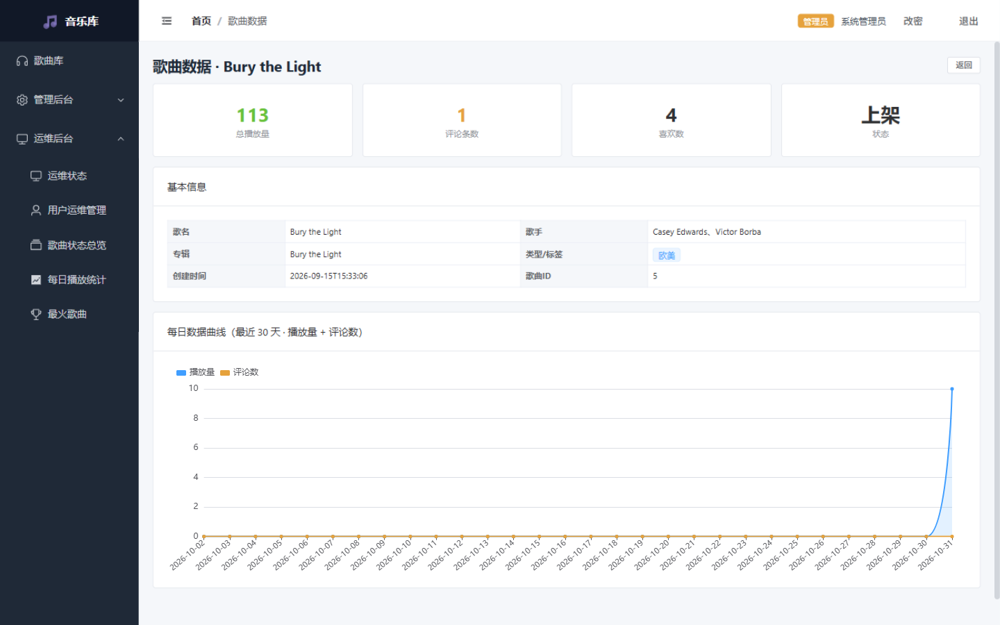
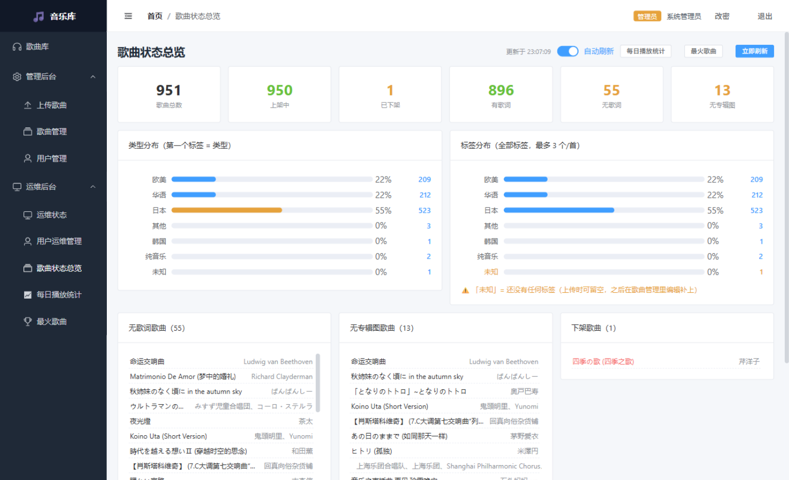
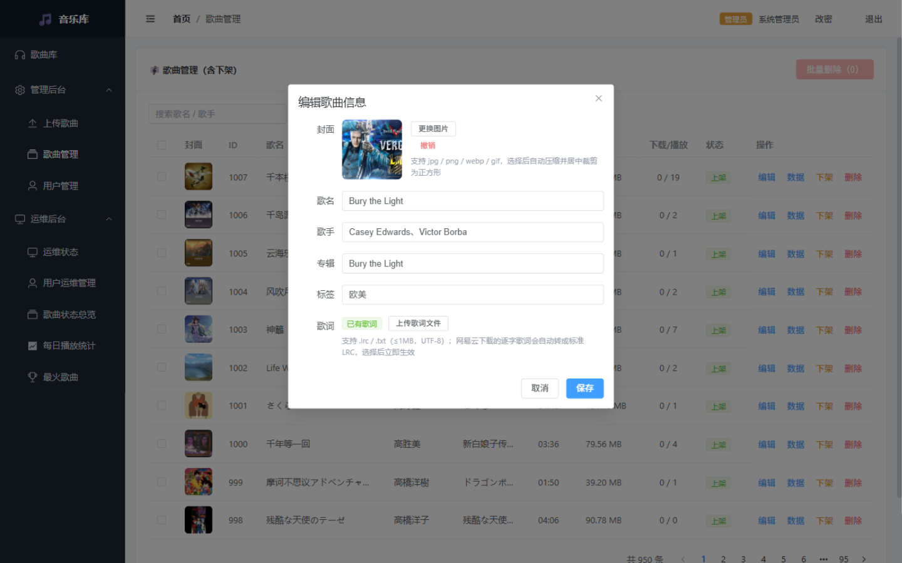
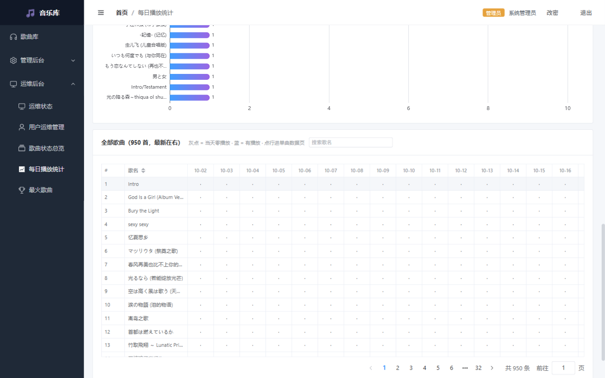

# 🎵 MusicHouse）V2 

一套完整的**本地音乐平台**：自建音乐库 + 歌曲标签分类 + 每日播放统计可视化 + 评论/歌单/收藏 + 运维监控。
后端 Spring Boot 2.7 + MyBatis-Plus + Redis，管理端 Vue3 + Element Plus，播放端 Vue3 + Naive UI（网易云风格界面）。

> 适合：个人/宿舍局域网自建音乐站、毕业设计、Spring Boot + Vue3 全栈学习参考。

---

## ✨ 功能特性

**播放端（网易云风格 Web 客户端）**

- 发现页：推荐歌单 + 推荐音乐（播放量最高 / 评论最多两类来源）
- 黑胶唱片歌词页：逐行歌词高亮、滚动定位、评论入口
- 搜索试听、歌单（创建/收藏/编辑）、我喜欢、最新音乐
- 评论 + 楼中楼回复 + 评论点赞
- 登录后才能浏览歌单/收藏（游客可搜索试听）
- 抓娃娃小游戏式人机验证（管理端登录强制）

**服务端（管理后台 5174）**
- 歌曲管理：上传（MD5 秒传）、编辑（封面压缩裁剪 / 歌词 LRC 转换）、上下架、批量删除
- 歌曲标签体系：类型（首标签）+ 最多 3 个标签，按标签精确筛选
- 歌曲状态总览：上下架/歌词/封面统计、类型与标签分布、三类待办明细（无歌词 / 无专辑图 / 下架，点击直达编辑）
- **每日播放统计**：每一首有播放的歌一条曲线、下拉框选歌显隐、区间播放排行 TOP50、全量分页表格
- **单曲数据页**：30 天播放量 + 评论数双曲线
- **最火歌曲 TOP50**：播放榜 + 评论榜（同量看评论 → 看播放 → 先创建优先）
- 运维中心：服务器监控（CPU/内存/JVM/磁盘，OSHI）、在线客户端实时列表（网页/桌面/移动分组）、运维状态快照
- 用户管理：禁用/删除（级联清理）、头像压缩上传
- 安全：JWT 登录、登录失败限流（Redis）、抓娃娃验证码票据（一次性消费）、忘记密码（恢复码自助重置）

---

## 🚀 V2 版本新增内容

| 模块 | 新增 |
|---|---|
| 每日播放统计 | 全新页面：每首有播放的歌一条曲线（可下拉框选歌显隐）、按天全量横轴、区间播放排行 TOP50（点击进单曲页）、全量分页表格（当日零播放显示灰点） |
| 单曲数据页 | 全新页面：一首歌的完整状态（播放/评论/喜欢/上架状态）+ 最近 30 天播放量与评论数**双曲线**（全量补零，趋势一目了然） |
| 歌曲状态总览 | 全新页面：统计卡 + 类型/标签分布（未打标签显示「未知」）+ 无歌词/无专辑图/下架三类明细全量滚动展示，点歌名直达编辑弹窗 |
| 最火歌曲 | 全新页面：播放 TOP50 + 评论 TOP50 双榜，支持搜索、分页、点击进单曲页 |
| 标签体系 | 类型 + 多标签（≤3 个/首），后台批量自动打标，列表按标签筛选 |
| 运维后台 | 服务器监控（OSHI）、在线客户端（平台归一化：admin/web/desktop/mobile，30 秒心跳）、运维状态 |
| Redis | 登录失败限流、验证码票据、公共列表缓存 |
| 账号安全 | 忘记密码（用户名 + 恢复码免登录重置）、登录后改密、防用户名枚举 |
| 推荐逻辑 | 推荐音乐 = 播放量 TOP30 + 评论 TOP20 去重；推荐歌单 = 最新 1 个 + 高播放 2 个 |

## 🔧 V2 版本修复内容

- **歌曲级联删除**：删除歌曲同时物理清除音频/封面/歌词文件 + 评论（含点赞）/播放历史/下载记录/每日播放统计/歌单关联，六表彻底清理
- **下载假文件**：接口报错时返回 JSON 却被存成 .mp3（78 字节假文件），已按 Content-Type 识别错误体并统一提示
- **每日播放统计页卡死**：950 行 × 30 列全量单元格渲染导致「页面无响应」，改为分页 + 懒加载，实测流畅
- **曲线挤压**：图表初始化时容器尺寸未稳定导致曲线挤成竖线，ResizeObserver 自适应根治
- **登录死循环**：401 后只清 localStorage 不清响应式状态，导致已登录访问登录页被弹回首页，永远无法重新登录
- **JWT 重启失效**：密钥每次随机导致重启后全体掉线，改为固定密钥（.env.local 配置）
- **好友单向残留**：删除好友只删一方关注关系，改为双向清理
- **搜索历史**：去重 + 最新置顶 + 上限 20 条
- **Lombok 随机编译失败**：关闭 Maven 增量编译（useIncrementalCompilation=false）

---

## 📦 快速开始

### 环境要求
- JDK 11、Maven 3.8+、Node.js 16+
- MySQL 8.x、Redis 6+

### 1. 数据库
```sql
CREATE DATABASE music_db DEFAULT CHARACTER SET utf8mb4;
-- 导入 music_db.sql（表结构；如未附带可由 JPA/建表脚本生成）
```

### 2. 后端配置
```bash
cd backend
copy .env.example .env.local    # 填入 MYSQL_USERNAME / MYSQL_PASSWORD 等，切勿提交此文件
```

### 3. 启动
```bash
# 方式一（Windows 推荐）：双击 scripts/启动-服务端.bat
#   自动：启动 MySQL(如未运行) → 加载 .env.local → 前台启动后端(8080)

# 方式二：手动
cd backend && mvn spring-boot:run

# 管理端(5174)
cd web-admin && npm install && npm run dev

# 播放端(5175)
cd web-user && npm install && npm run dev
```

### 4. 默认账号
| 端 | 账号 | 说明 |
|---|---|---|
| 管理端/播放端 | admin / admin123 | **演示用，部署后请立即修改** |

- 播放端配置：`web-user/public/config.json` 的 `apiBase: "auto"`（自动跟随页面主机，局域网设备直接访问）
- 登录需要先完成抓娃娃人机验证（管理端强制）

---

##  部分界面截图

### 客户端
| 发现页（推荐歌单 + 推荐音乐 + 播放条） | 黑胶歌词页（逐行高亮） |
|---|---|
|  |  |

### 服务端（管理后台）
| 每日播放统计（每首歌一条曲线 + 下拉选歌） | 区间播放排行（下拉框展开） |
|---|---|
|  |  |

| 单曲数据页（30 天播放 + 评论双曲线） | 歌曲状态总览（分布 + 待办明细） |
|---|---|
|  |  |

| 歌曲管理（编辑弹窗直达） | 状态总览明细（全量滚动展示） |
|---|---|
|  |  |

---

## 📂 目录结构

```
├── backend/             # 后端 Spring Boot 2.7（API + 管理端接口 + 运维监控）
├── web-admin/           # 管理后台 Vue3 + Element Plus（端口 5174）
├── web-user/            # 播放端 Vue3 + Naive UI（端口 5175，网易云风格，含 Electron 桌面壳）
├── sql/                 # 建表脚本 + 结构/演示数据
├── scripts/             # 启动/部署脚本（Windows + Kali）
└── docs/                # 文档与界面截图
```

## 🛠 技术栈

`Spring Boot 2.7` `MyBatis-Plus` `Redis` `Druid` `JWT` `OSHI` · `Vue3` `Vite` `Element Plus` `Naive UI` `ECharts` `Pinia`

## ⚠️ 说明
- 本项目仅供学习交流，请自备音乐文件并尊重版权
- 无封面的歌曲自动回退内置默认封面；无歌词显示「暂无歌词」
- `.env.local` 含数据库凭据，已在 .gitignore 中排除，切勿提交
- 该项目持续更新迭代中，后续有更多有趣功能。

## 🙏 致谢
- [FeralUI / playcaptcha](https://github.com/mortspace/feralui)（MIT）—— 抓娃娃人机验证的原型（本项目使用其 Vue 3 移植版，后端票据校验为自研实现）

## 📄 License
[MIT](LICENSE)